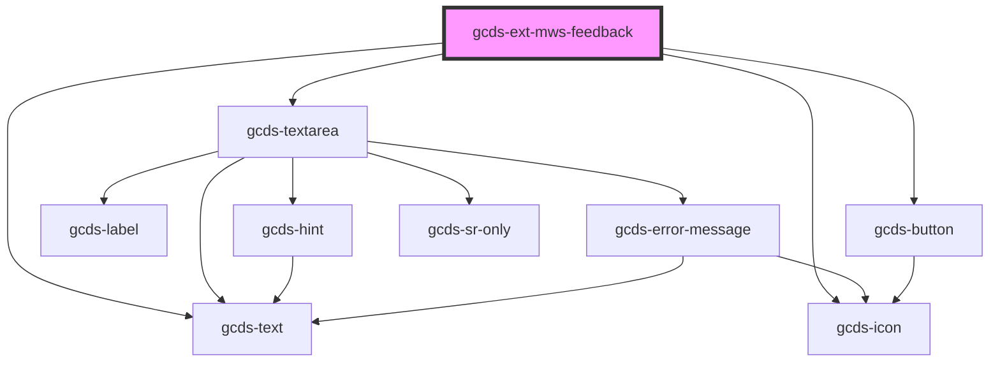

# app-alert

<!-- Auto Generated Below -->

## Properties

| Property  | Attribute | Description                                                                        | Type     | Default                                                         |
| --------- | --------- | ---------------------------------------------------------------------------------- | -------- | --------------------------------------------------------------- |
| `action`  | `action`  | Defines the URL where the feedback should be submitted                             | `string` | `'https://feedback-retroaction.canada.ca/api/QueueProblemForm'` |
| `section` | `section` | Defines the section where your page resides (sent as data via the form submission) | `string` | `''`                                                            |
| `theme`   | `theme`   | Defines the theme of your page (sent as data via the form submission)              | `string` | `''`                                                            |

## Events

| Event            | Description                                               | Type                |
| ---------------- | --------------------------------------------------------- | ------------------- |
| `feedbackNo`     | Triggered when the user select "No"                       | `CustomEvent<void>` |
| `feedbackSubmit` | Triggered when the user select "Yes" or submits a comment | `CustomEvent<void>` |

## Slots

| Slot | Description                        |
| ---- | ---------------------------------- |
|      | The main content of the container. |

## Dependencies

### Depends on

- gcds-text
- gcds-icon
- gcds-textarea
- gcds-button

### Graph

----------------------------------------------

*Built with [StencilJS](https://stenciljs.com/)*
