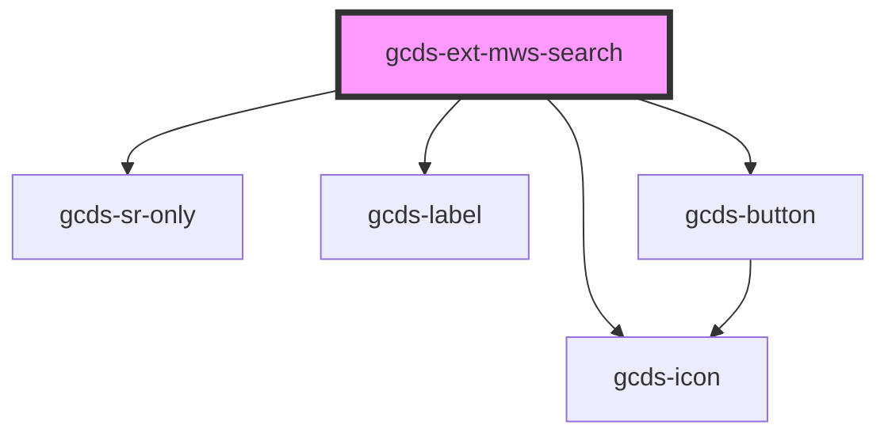

# gcds-ext-mws-search

<!-- Auto Generated Below -->

## Overview

Search is a space for entering keywords to find relevant information.

## Properties

| Property                    | Attribute                     | Description                                                                             | Type              | Default                           |
| --------------------------- | ----------------------------- | --------------------------------------------------------------------------------------- | ----------------- | --------------------------------- |
| `action`                    | `action`                      | Sets the action for the search form. Default will be canada.ca global search            | `string`          | `'/sr/srb.html'`                  |
| `method`                    | `method`                      | Set the form method of the search form                                                  | `"get" \| "post"` | `'get'`                           |
| `name`                      | `name`                        | Set the name of the search input                                                        | `string`          | `'q'`                             |
| `placeholder`               | `placeholder`                 | Set the placeholder and label for the search input. Becomes "Search [placeholder]"      | `string`          | `'Canada.ca'`                     |
| `searchId`                  | `search-id`                   | Set the id of the search input                                                          | `string`          | `'search'`                        |
| `suggestionsAccessToken`    | `suggestions-access-token`    | Bearer token used to access the suggestions API. Suggestions are disabled when omitted. | `string`          | `''`                              |
| `suggestionsEndpoint`       | `suggestions-endpoint`        | Base URL for the Canada.ca query suggestions API, without the /querySuggest path.       | `string`          | `'https://apps.canada.ca/search'` |
| `suggestionsMaxItems`       | `suggestions-max-items`       | Maximum number of suggestions requested from the API.                                   | `number`          | `5`                               |
| `suggestionsMinCharacters`  | `suggestions-min-characters`  | Minimum number of input characters before suggestions are requested.                    | `number`          | `3`                               |
| `suggestionsOrganizationId` | `suggestions-organization-id` | Organization ID used to access the suggestions API.                                     | `string`          | `''`                              |
| `suggestionsPipeline`       | `suggestions-pipeline`        | Pipeline sent with each suggestions request.                                            | `string`          | `''`                              |
| `suggestionsSearchHub`      | `suggestions-search-hub`      | Search hub sent with each suggestions request.                                          | `string`          | `''`                              |
| `value`                     | `value`                       | Set the value of the search input                                                       | `string`          | `undefined`                       |

## Events

| Event        | Description                                         | Type                  |
| ------------ | --------------------------------------------------- | --------------------- |
| `gcdsBlur`   | Emitted when the search input has lost focus.       | `CustomEvent<void>`   |
| `gcdsChange` | Emitted when the search input value has changed.    | `CustomEvent<string>` |
| `gcdsFocus`  | Emitted when the search input has gained focus.     | `CustomEvent<void>`   |
| `gcdsInput`  | Emitted when the search element has received input. | `CustomEvent<string>` |
| `gcdsSubmit` | Emitted when the search form has submitted.         | `CustomEvent<string>` |

## Dependencies

### Depends on

- gcds-icon
- gcds-sr-only
- gcds-label
- gcds-button

### Graph

----------------------------------------------

*Built with [StencilJS](https://stenciljs.com/)*
