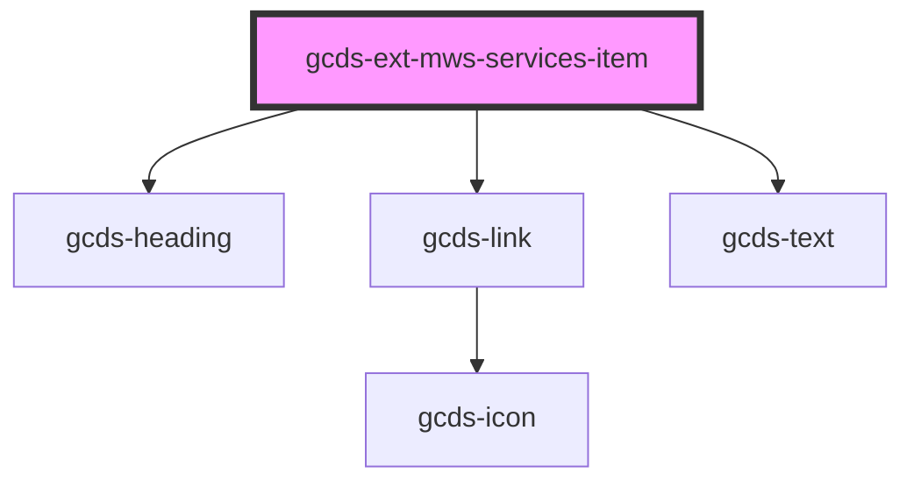

# app-alert

<!-- Auto Generated Below -->

## Properties

| Property            | Attribute     | Description                                                                           | Type     | Default     |
| ------------------- | ------------- | ------------------------------------------------------------------------------------- | -------- | ----------- |
| `description`       | `description` | Optional description. If omitted, the component will render the default slot instead. | `string` | `undefined` |
| `heading`           | `heading`     | Service title.  Used as a fallback when the heading slot is not provided.             | `string` | `undefined` |
| `href` _(required)_ | `href`        | Link href                                                                             | `string` | `undefined` |

## Slots

| Slot        | Description                        |
| ----------- | ---------------------------------- |
|             | The main content of the container. |
| `"heading"` | Custom heading content.            |

## Dependencies

### Depends on

- gcds-heading
- gcds-link
- gcds-text

### Graph

----------------------------------------------

*Built with [StencilJS](https://stenciljs.com/)*
