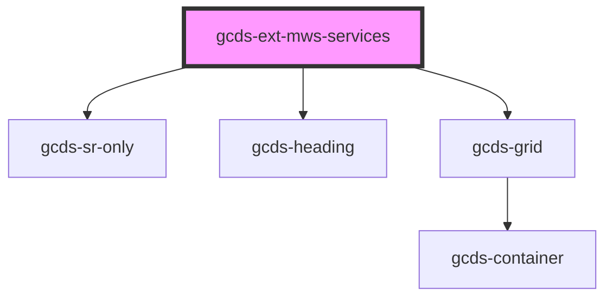

# app-alert

<!-- Auto Generated Below -->

## Properties

| Property               | Attribute      | Description                                                            | Type          | Default     |
| ---------------------- | -------------- | ---------------------------------------------------------------------- | ------------- | ----------- |
| `columns`              | `columns`      | Number of columns to distribute items across. Allowed values: 1, 2, 3. | `1 \| 2 \| 3` | `3`         |
| `heading` _(required)_ | `heading`      | Mandatory - Heading text                                               | `string`      | `undefined` |
| `hideHeading`          | `hide-heading` | Hide the Heading visually.                                             | `boolean`     | `false`     |

## Slots

| Slot        | Description                        |
| ----------- | ---------------------------------- |
|             | The main content of the container. |
| `"heading"` | Custom heading content.            |

## Dependencies

### Depends on

- gcds-sr-only
- gcds-heading
- gcds-grid

### Graph

----------------------------------------------

*Built with [StencilJS](https://stenciljs.com/)*
